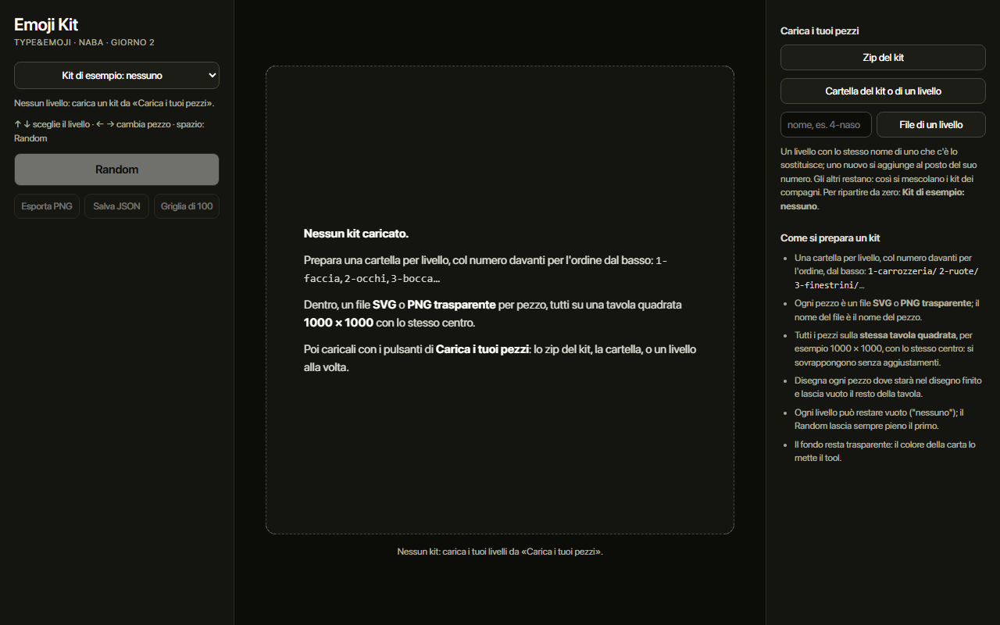
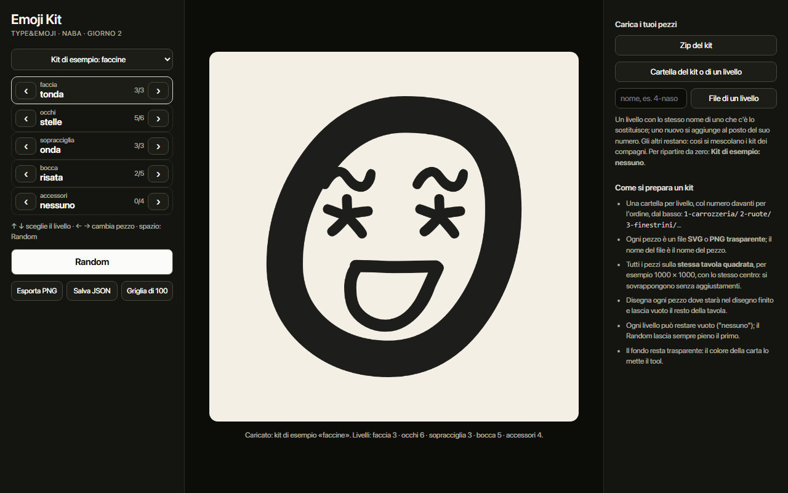
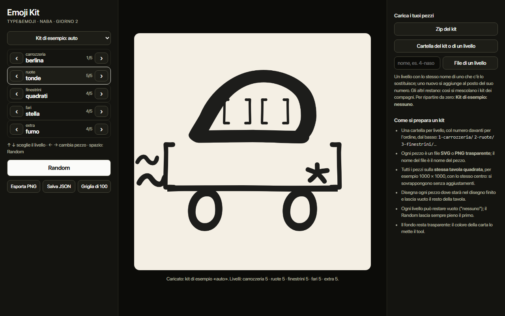
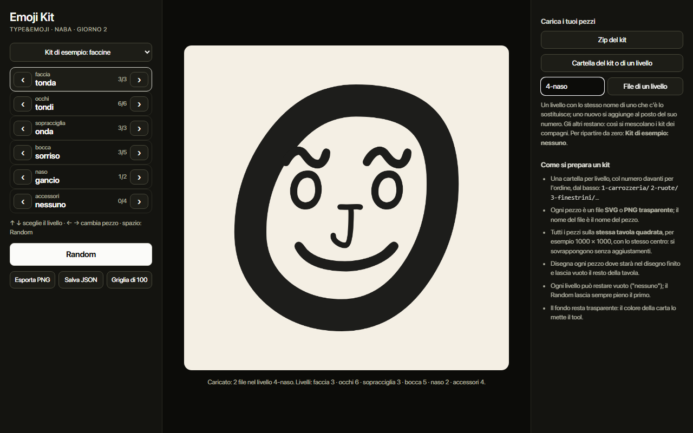
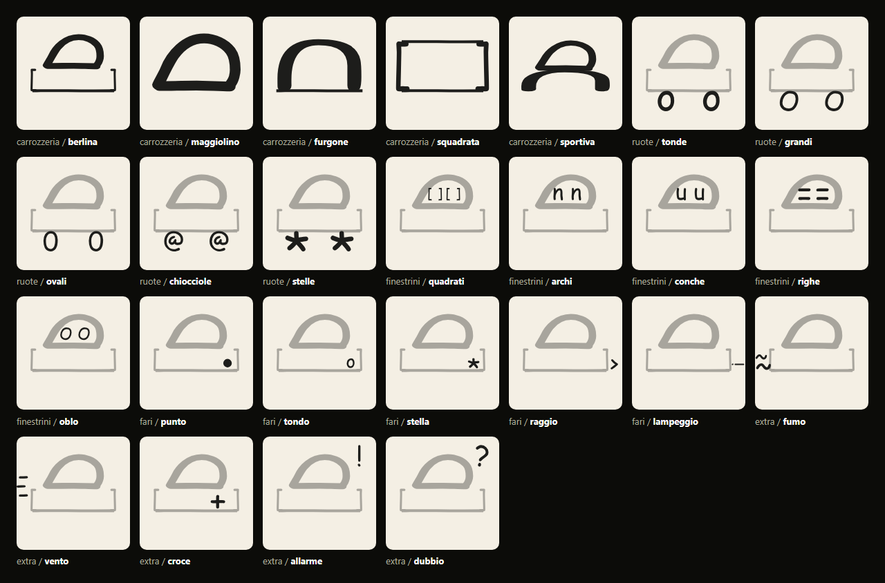
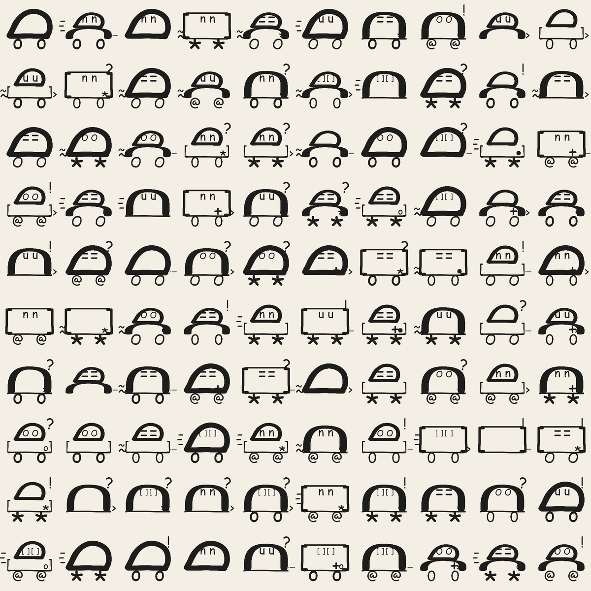

# TYPE&EMOJI - Emoji Kit

**Online: https://neve-studio.github.io/type-emoji/** (GitHub Pages dalla radice di `master`: si apre dal browser, niente da scaricare).

Tool p5.js per il giorno 2 del workshop TYPE&EMOJI (NABA, 3-4/12/2026, Fabrizio Falcone e Simone Verduci).

Un'emoji è una pila di pezzi, uno per livello, come nei generatori di NFT a tratti. **I livelli li decide il kit**: sono le sue cartelle, in ordine col numero davanti al nome. Una faccina può essere `1-faccia` `2-occhi` `3-sopracciglia` `4-bocca` `5-accessori`; un'auto `1-carrozzeria` `2-ruote` `3-finestrini` `4-fari` `5-extra`; un mostro, una casa, una pianta quello che serve. Ogni livello si sfoglia con ‹ › (passando da "nessuno"), il Random pesca un pezzo a caso per livello, e si esporta l'emoji in PNG, la combinazione in JSON e una griglia di 100 emoji casuali in PNG.

I pezzi sono quelli disegnati il giorno 1 con i glifi del proprio carattere. **La pagina parte vuota**: nessun kit, e al posto dell'emoji tre righe che dicono come preparare il proprio (cartelle numerate, un SVG o PNG trasparente per pezzo, tavola 1000 × 1000) e da dove caricarlo. Random, frecce ed export restano spenti finché non c'è un kit. Ci sono due kit di esempio fatti con i glifi di Comic Sans, **faccine** e **auto**: si caricano solo su richiesta, dal menu in alto a sinistra (che parte su "nessuno") o dall'indirizzo:

- `?demo` carica le faccine, per la proiezione: https://neve-studio.github.io/type-emoji/?demo
- `?kit=comic-sans` le faccine, `?kit=auto-comic-sans` le auto.








La versione precedente del tool (Emoji Press: font → primitive → emoji) sta intera in [`archive/emoji-press-v1/`](archive/emoji-press-v1/).

## Come si apre

Servono solo un browser e la rete (p5.js e JSZip arrivano da CDN). Niente da installare, niente build.

1. **Doppio clic su `index.html`.** Funziona anche da `file://`: i kit di esempio sono anche in `kits/comic-sans/kit.js` e `kits/auto-comic-sans/kit.js`, proprio per questo. La pagina li legge solo quando li si sceglie: senza la cartella `kits/` funziona lo stesso, e il menu dice che il kit manca.
2. **Da un server statico**, se il browser fa storie con i file locali:
   ```
   python -m http.server 8000
   ```
   e poi `http://localhost:8000`.
3. **In editor.p5js.org** (non provato, vedi sotto): nuovo sketch, poi nel pannello dei file si sostituiscono `index.html`, `sketch.js` e `style.css` con quelli di questo repo e si carica `kit-tools.js`. Bastano questi quattro file; i kit gli studenti li caricano dai pulsanti.

### I due zip

`python tools/make_editor_zip.py` scrive in `dist/`:

- **`emoji-kit-studenti.zip`**: solo `index.html`, `sketch.js`, `style.css`, `kit-tools.js`. Parte vuoto. È quello da dare agli studenti: https://neve-studio.github.io/type-emoji/dist/emoji-kit-studenti.zip
- **`emoji-kit-demo.zip`**: gli stessi quattro file più `kits/comic-sans/` e `kits/auto-comic-sans/`, per far vedere gli esempi (menu, `?demo`, `?kit=`): https://neve-studio.github.io/type-emoji/dist/emoji-kit-demo.zip

Gli zip sono nel repo e vanno rifatti quando cambia uno dei quattro file.

Tastiera: **↑ ↓** sceglie il livello, **← →** cambia pezzo, **spazio** fa Random.

## I file

| File | Cosa |
|---|---|
| `sketch.js` | **Il file da modificare** (165 righe): disegno, Random, regole, colori, animazioni, export |
| `kit-tools.js` | Il codice di servizio: caricare i pezzi, il pannello, i pulsanti. Non serve toccarlo |
| `index.html`, `style.css` | La pagina |
| `kits/comic-sans/` | Il kit di esempio delle faccine: una cartella per livello con gli SVG, più `kit.js` con gli stessi dati |
| `kits/auto-comic-sans/` | Il kit di esempio delle auto, fatto allo stesso modo |
| `tools/make_comic_kit.py`, `tools/make_car_kit.py` | Gli script che generano i due kit da `comic.ttf` |
| `tools/make_editor_zip.py`, `dist/` | Lo script dei due zip e gli zip |
| `test/kit_test.py` | La prova automatica (Playwright) |

## Come si prepara un kit

Prima di disegnare si decide il **sistema di livelli**: in quanti pezzi si smonta il disegno, e cosa sta sopra a cosa. Una buona regola: il primo livello è il corpo (la faccia, la carrozzeria), gli altri sono le parti che ci stanno sopra, e l'ultimo è quello che può esserci o no (un accessorio, il fumo). Da tre a sei livelli bastano.

1. **Una cartella per livello, col numero davanti per l'ordine**, dal basso verso l'alto: `1-carrozzeria/` sta sotto a `2-ruote/`. Il numero può essere scritto `1-`, `01_` o `1 `; in pagina non si vede, si vede solo `carrozzeria`. Senza numeri i livelli vanno in ordine alfabetico, che quasi mai è quello giusto.
2. **Ogni pezzo è un file SVG o PNG trasparente.** Il nome del file è il nome del pezzo (`2-ruote/tonde.svg` → "tonde"); in pagina i pezzi vanno in ordine alfabetico.
3. **Tutti i pezzi sulla stessa tavola quadrata**, per esempio 1000 × 1000, **con lo stesso centro**, in tutti i livelli. Il tool li sovrappone tutti a tavola intera, senza spostarli.
4. **Ogni pezzo si disegna dove starà nel disegno finito**: gli occhi in alto, la bocca in basso; le ruote sotto la carrozzeria, appoggiate a terra. Il resto della tavola resta vuoto.
5. **Il fondo resta trasparente**: il colore della carta lo mette il tool (`PAPER` in `sketch.js`).

Ogni livello ha anche la scelta **"nessuno"**: con le frecce ci si arriva in tutti i livelli, il Random la può pescare in tutti tranne il primo, che resta sempre pieno (un'emoji senza faccia o un'auto senza carrozzeria non si disegna). Se un altro livello non deve mai restare vuoto, lo dice una regola in `sketch.js` (vedi l'esempio 3 delle REGOLE).

Il modo più semplice è un file Illustrator o Figma con una tavola 1000 × 1000 e un livello per pezzo: si accende un livello alla volta e si esporta la tavola intera. Un SVG esportato senza `width` e `height` (il "responsive" di Illustrator) va bene lo stesso: il tool gli dà la misura della tavola.

Poi si carica dalla colonna di destra:

- **Zip del kit**: uno zip con le cartelle dei livelli dentro (anche dentro una cartella in più, come fa il Mac quando comprime);
- **Cartella del kit o di un livello**: la cartella che contiene le cartelle dei livelli, oppure la cartella di un livello solo (`4-naso/`): il tool capisce da sé quale delle due;
- **File di un livello**: si scrive il nome del livello nel campo (`4-naso`), poi si scelgono i file.

**Caricare non cancella niente**: un livello con lo stesso nome di uno che c'è lo sostituisce, uno nuovo si aggiunge al posto del suo numero (a parità di numero, in ordine alfabetico), gli altri restano. Così si mescolano i kit: le faccine di uno con il naso di un altro. Per ripartire da zero c'è **Kit di esempio: nessuno** nel menu in alto. Un livello ricaricato senza numero resta dov'era.

I kit fatti prima dei livelli liberi, con le cinque cartelle `faccia/` `occhi/` `sopracciglia/` `bocca/` `accessori/` senza numeri, funzionano ancora: quelle cinque tengono il loro ordine di sempre.

I file che non sono SVG o PNG (un `LEGGIMI.txt`, la `__MACOSX` del Mac) si ignorano; un file che non si legge è nominato in rosso sotto l'emoji.



### I kit di esempio

Sono fatti con glifi veri di Comic Sans (`C:\Windows\Fonts\comic.ttf`) convertiti in tracciati, tutti sulla tavola 1000 × 1000 con lo stesso centro. Li rigenerano:

```
python tools/make_comic_kit.py
python tools/make_car_kit.py
```

(serve `fontTools`: `pip install fonttools`). Gli script scrivono gli SVG, `kit.js` e stampano le tabelle qui sotto.

#### Faccine, `kits/comic-sans/`


| Livello | Pezzo | Glifi |
|---|---|---|
| 1-faccia | tonda | `O` |
| 1-faccia | ovale | `0` |
| 1-faccia | parentesi | `(` `)` |
| 2-occhi | punti | `.` |
| 2-occhi | tondi | `o` |
| 2-occhi | felici | `^` |
| 2-occhi | croce | `x` |
| 2-occhi | chiusi | `)` ruotata di 90° |
| 2-occhi | stelle | `*` |
| 3-sopracciglia | dritte | `-` |
| 3-sopracciglia | onda | `~` |
| 3-sopracciglia | arrabbiate | `/` ruotata di 35° e `\` ruotata di -35° |
| 4-bocca | sorriso | `)` ruotata di 90° |
| 4-bocca | triste | `)` ruotata di -90° |
| 4-bocca | risata | `D` ruotata di 90° |
| 4-bocca | stupita | `O` |
| 4-bocca | piatta | `_` |
| 5-accessori | lacrima | `,` ruotata di -20° |
| 5-accessori | sonno | `Z` `z` |
| 5-accessori | stupore | `!` |
| 5-accessori | dubbio | `?` |

Gli occhi e le sopracciglia sono lo stesso glifo ripetuto due volte.

#### Auto, `kits/auto-comic-sans/`

Cinque livelli da cinque pezzi. La carrozzeria è fatta con glifi stirati (una `D` coricata è il tetto, `[` `]` e `_` sono la fiancata); le ruote, i finestrini e i fari sono glifi ripetuti; le ruote toccano terra alla stessa altezza in tutti i pezzi.



| Livello | Pezzo | Glifi |
|---|---|---|
| 1-carrozzeria | berlina | `D` ruotata di -90° `[` `]` `_` |
| 1-carrozzeria | maggiolino | `D` ruotata di -90° |
| 1-carrozzeria | furgone | `U` ruotata di 180° `_` |
| 1-carrozzeria | squadrata | `[` `]` `_` |
| 1-carrozzeria | sportiva | `D` ruotata di -90° `U` ruotata di 180° |
| 2-ruote | tonde | `o` |
| 2-ruote | grandi | `O` |
| 2-ruote | ovali | `0` |
| 2-ruote | chiocciole | `@` |
| 2-ruote | stelle | `*` |
| 3-finestrini | quadrati | `[` `]` |
| 3-finestrini | archi | `n` |
| 3-finestrini | conche | `u` |
| 3-finestrini | righe | `=` |
| 3-finestrini | oblo | `O` |
| 4-fari | punto | `.` |
| 4-fari | tondo | `o` |
| 4-fari | stella | `*` |
| 4-fari | raggio | `>` |
| 4-fari | lampeggio | `!` ruotata di 90° |
| 5-extra | fumo | `~` |
| 5-extra | vento | `-` |
| 5-extra | croce | `+` |
| 5-extra | allarme | `!` |
| 5-extra | dubbio | `?` |



Nella griglia alcune auto non hanno le ruote: è il "nessuno" del Random. L'esempio 3 delle REGOLE lo toglie.

## Il pomeriggio: tre punti in `sketch.js`

In `sketch.js` ci sono tre punti segnati `===== COLORI =====`, `===== REGOLE =====` e `===== ANIMAZIONI =====`. Ognuno ha esempi pronti: si tolgono i `//` davanti e si ricarica la pagina.

- **COLORI**, la funzione `inkOf(layer, c)`: di che colore si disegna un pezzo. Esempi: gli occhi sempre rossi; ogni faccia ha il suo colore e lo dà a tutta l'emoji.
- **REGOLE**, la funzione `allowed(c)`: il Random le chiede se la combinazione va bene, e se no la rifà. Esempi: gli occhi chiusi non escono mai con la lacrima; gli occhi a croce escono una volta su dieci; l'auto ha sempre le ruote.
- **ANIMAZIONI**, dentro `drawEmoji`: prima di disegnare un pezzo lo si può nascondere, spostare, ingrandire. Esempi: gli occhi sbattono, la bocca respira, gli accessori dondolano, l'auto sobbalza sulle ruote.

I livelli si chiamano col nome della cartella senza il numero: `nameOf('ruote', c)` dà il nome del pezzo scelto, o `null` se è "nessuno". Una regola su un livello che il kit non ha non fa niente: gli esempi delle faccine e dell'auto possono stare accesi insieme. Le regole valgono anche per la griglia di 100. Gli export restano fermi (sono il fotogramma 0).


### Cinque prompt per l'AI

Si incolla `sketch.js` nella chat e poi si chiede una cosa sola alla volta. Con i nomi dei propri pezzi, non con quelli del kit di esempio.

1. «Nella funzione `allowed`, fai in modo che gli occhi `chiusi` non escano mai con l'accessorio `lacrima`.»
2. «Nella funzione `inkOf`, dai a ogni carrozzeria il suo colore (`berlina` blu, `furgone` rosso, `sportiva` verde) e usalo per tutti i pezzi dell'auto.»
3. «Nella parte ANIMAZIONI di `drawEmoji`, fai girare le ruote: ogni ruota ruota intorno al suo centro (sulla tavola da 1000 i centri sono a x 300 e 700, y 745).»
4. «Il mio kit ha i livelli `1-corpo`, `2-occhi`, `3-zampe`, `4-coda`. Fai in modo che le zampe non restino mai vuote e che la coda esca una volta su tre, e spiegami riga per riga cosa hai cambiato.»
5. «Quando un'emoji ha gli occhi `stelle`, colorali di giallo e falli lampeggiare una volta al secondo; il resto resta com'è.»

Se qualcosa si rompe, la console del browser (F12) dice la riga; si incolla l'errore nella chat.

## Provato e non provato

`python test/kit_test.py` (serve `pip install playwright pillow`, ed Edge o il Chromium di Playwright) rifà i due zip e apre la pagina headless **due volte, da `file://` e da `python -m http.server`**, e prova:

- l'avvio vuoto: nessun livello, il menu su "nessuno", le tre righe di istruzioni, Random ed export spenti; frecce, spazio, clic forzati sui pulsanti spenti e `randomize()` dalla console senza errori; poi uno zip caricato, con frecce, Random, PNG, JSON e griglia;
- `?demo` (le faccine) e `?kit=auto-comic-sans` (le auto);
- la copia di `emoji-kit-studenti.zip` (solo i quattro file), da `file://` e da server: l'avvio vuoto e lo zip come sopra, il menu e `?demo` che dicono che il kit manca, nessun errore se non il file `kits/…/kit.js` che non c'è; la copia di `emoji-kit-demo.zip` con `?kit=auto-comic-sans`;
- su una copia, tutti gli esempi di `sketch.js` scommentati insieme, a kit vuoto, con uno zip, con le auto: nessun errore;
- con le faccine: le frecce ‹ › in tutti i livelli fino a "nessuno" (anche il primo), il clic su una riga, la tastiera (↑ ↓ ← →, spazio) senza che la pagina scorra; 3000 Random, con la faccia mai "nessuno" e gli altri livelli "nessuno" qualche centinaio di volte;
- l'export PNG (1000 × 1000), il JSON (uguale alla combinazione in pagina, `null` per "nessuno"), la griglia (2000 × 2000);
- il kit auto dal menu: cinque livelli da cinque pezzi, frecce, tastiera, 3000 Random con la carrozzeria mai "nessuno", la griglia;
- su **Kit di esempio: nessuno**, uno zip vecchio con le cinque cartelle senza numeri dentro una cartella in più, con un PNG trasparente, un SVG senza `width`/`height`, una `__MACOSX` e un `.txt` da ignorare: i livelli escono nell'ordine delle faccine;
- uno zip con `01_zeta/`, `2 alfa/`, `3-mezzo/` (tre quadrati rosso, verde, blu uno dentro l'altro): l'ordine delle righe e i pixel dell'emoji dicono che vince il numero, non l'alfabeto;
- sulle faccine, il livello `4-naso` aggiunto con il campo del nome e due PNG (e prima, senza nome, il messaggio che lo chiede); poi una cartella `2-occhi/` con due pezzi che sostituisce gli occhi, e una cartella di kit intera;
- nessun errore e nessun warning in console;
- il pomeriggio, su una copia: scommenta le regole 1 e 3 e il colore 2, poi controlla 0 occhi chiusi con lacrima su 3000 Random, i pixel della faccia tutti nel suo colore, e 0 auto senza ruote su 3000 Random (la stessa regola sulle faccine, che non hanno ruote, non fa niente).

`python test/kit_test.py --online https://neve-studio.github.io/type-emoji/` prova l'avvio vuoto sulla pagina pubblicata, rifà le prove delle faccine su `?demo` (pomeriggio escluso), controlla la risposta 200 della pagina e dei due zip in `dist/` e salva `docs/screens/07-online.png`.


Lo screenshot online è ancora quello della versione con le cinque categorie fisse: l'avvio vuoto e i livelli liberi vanno riprovati online dopo la pubblicazione.

**Non provato:**

- **l'avvio vuoto e i livelli liberi sulla pagina online**: provati solo in locale (`file://` e `http.server`), la prova `--online` va rilanciata dopo la pubblicazione;
- **editor.p5js.org**: lo zip degli studenti è provato come copia locale dei quattro file, ma non l'ho caricato nell'editor;
- **Safari, Firefox e il Mac**: provato con Edge e con il Chromium di Playwright su Windows e, sulla pagina online, con WebKit 18.2 di Playwright (il motore di Safari, ma girato su Windows); Safari vero su un Mac e Firefox no;
- **gli esempi di ANIMAZIONI**: non c'è una prova automatica (lo sbattere degli occhi, il respiro, il dondolio, il sobbalzo dell'auto), vanno guardati a occhio;
- **la scelta di una cartella vera da Finder o da Esplora risorse**: il test la passa all'input come fa Playwright, non con la finestra del sistema;
- **il trascinamento** dei file sulla pagina: non c'è, si carica dai pulsanti;
- **ricaricare un JSON salvato**: il JSON si salva ma il tool non lo rilegge.

Per rifare gli screenshot di `docs/screens/` basta rilanciare il test.
