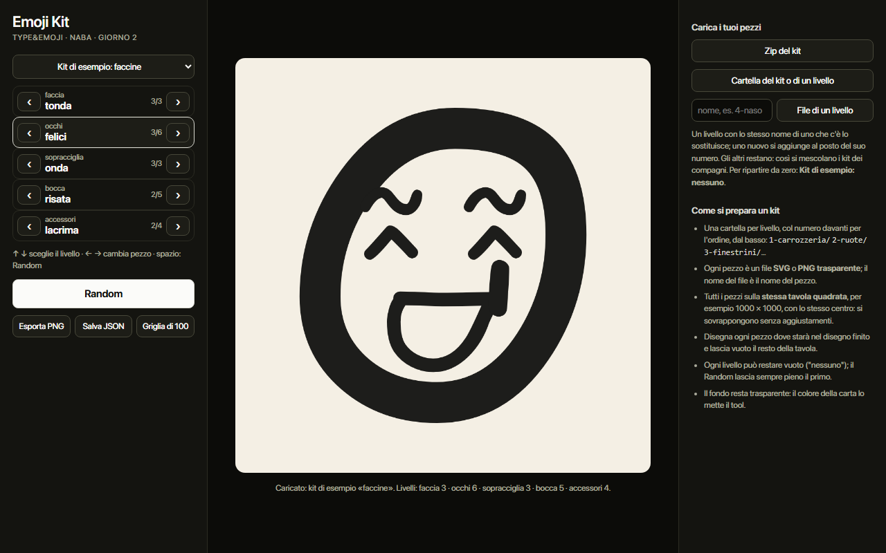
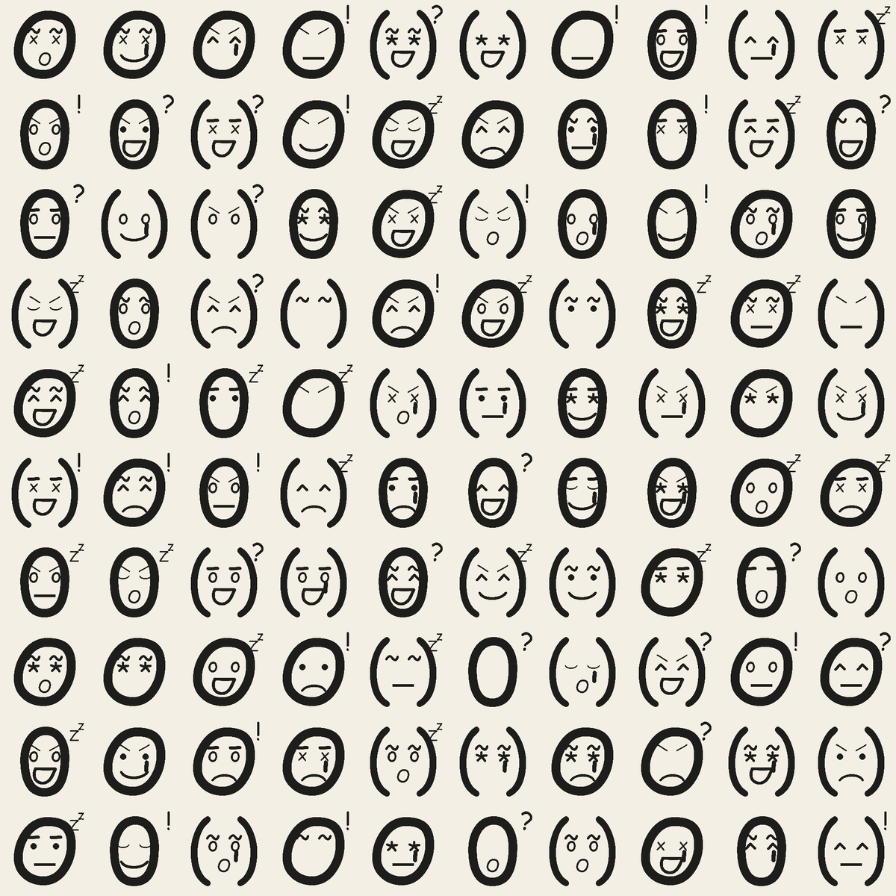
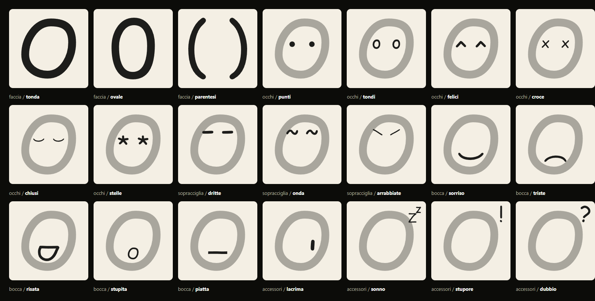
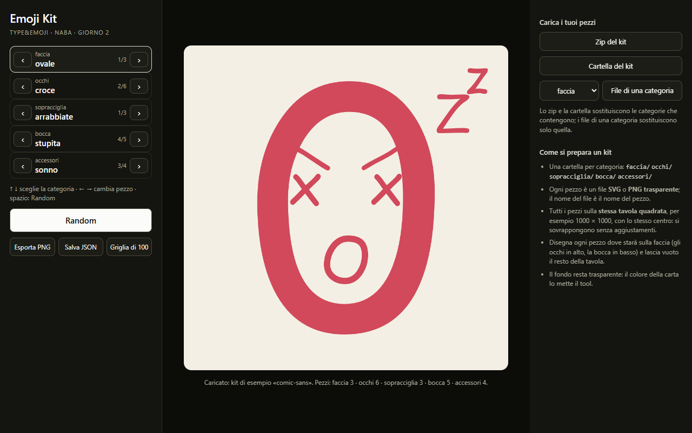
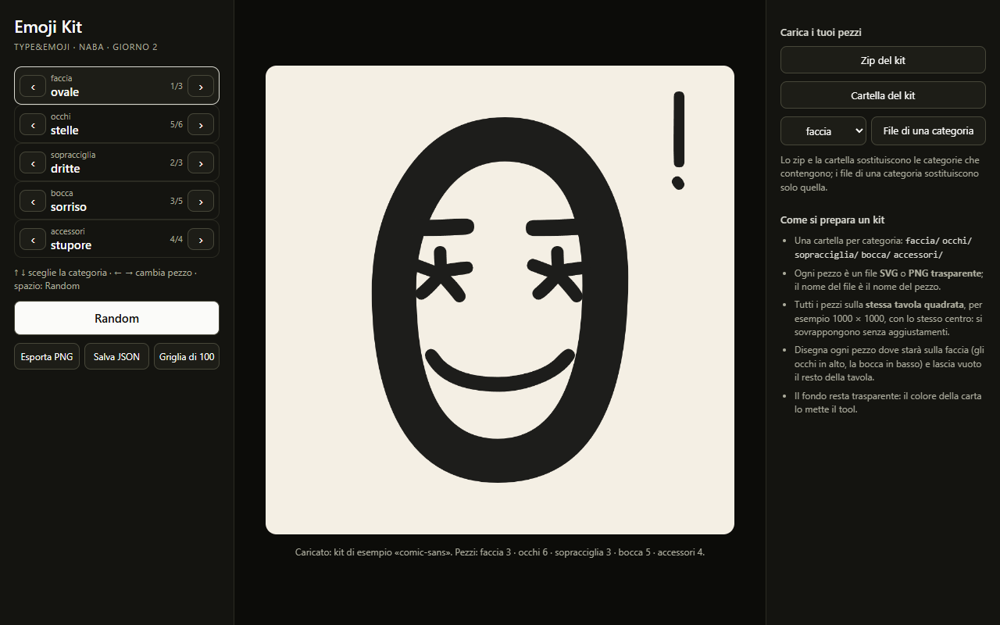

# TYPE&EMOJI - Emoji Kit

**Online: https://neve-studio.github.io/type-emoji/** (GitHub Pages dalla radice di `master`: si apre dal browser, niente da scaricare).

Tool p5.js per il giorno 2 del workshop TYPE&EMOJI (NABA, 3-4/12/2026, Fabrizio Falcone e Simone Verduci).

Un'emoji è una pila di pezzi, uno per categoria, come nei generatori di NFT a tratti: **faccia, occhi, sopracciglia, bocca, accessori**, dal basso verso l'alto. Ogni categoria si sfoglia con ‹ ›, il Random pesca un pezzo a caso per categoria (gli accessori possono anche non esserci), e si esporta l'emoji in PNG, la combinazione in JSON e una griglia di 100 emoji casuali in PNG.

I pezzi sono quelli disegnati il giorno 1 con i glifi del proprio carattere. All'avvio c'è un kit di esempio fatto con i glifi di Comic Sans.





La versione precedente del tool (Emoji Press: font → primitive → emoji) sta intera in [`archive/emoji-press-v1/`](archive/emoji-press-v1/).

## Come si apre

Servono solo un browser e la rete (p5.js e JSZip arrivano da CDN). Niente da installare, niente build.

1. **Doppio clic su `index.html`.** Funziona anche da `file://`: il kit di esempio è anche in `kits/comic-sans/kit.js`, proprio per questo.
2. **Da un server statico**, se il browser fa storie con i file locali:
   ```
   python -m http.server 8000
   ```
   e poi `http://localhost:8000`.
3. **In editor.p5js.org** (non provato, vedi sotto): nuovo sketch, poi nel pannello dei file
   - si sostituiscono `index.html`, `sketch.js` e `style.css` con quelli di questo repo;
   - si carica `kit-tools.js`;
   - si crea la cartella `kits`, dentro `comic-sans`, e dentro si carica `kit.js`.

   Basta solo `kit.js` dal kit di esempio: gli SVG sono già dentro.

Tastiera: **↑ ↓** sceglie la categoria, **← →** cambia pezzo, **spazio** fa Random.

## I file

| File | Cosa |
|---|---|
| `sketch.js` | **Il file da modificare** (161 righe): disegno, Random, regole, colori, animazioni, export |
| `kit-tools.js` | Il codice di servizio: caricare i pezzi, il pannello, i pulsanti. Non serve toccarlo |
| `index.html`, `style.css` | La pagina |
| `kits/comic-sans/` | Il kit di esempio: una cartella per categoria con gli SVG, più `kit.js` con gli stessi dati |
| `tools/make_comic_kit.py` | Lo script che genera il kit di esempio da `comic.ttf` |
| `test/kit_test.py` | La prova automatica (Playwright) |

## Come si prepara un kit

1. **Una cartella per categoria**, con questi nomi: `faccia/` `occhi/` `sopracciglia/` `bocca/` `accessori/`.
2. **Ogni pezzo è un file SVG o PNG trasparente.** Il nome del file è il nome del pezzo (`occhi/tondi.svg` → "tondi"); in pagina i pezzi vanno in ordine alfabetico.
3. **Tutti i pezzi sulla stessa tavola quadrata**, per esempio 1000 × 1000, con lo stesso centro. Il tool li sovrappone tutti a tavola intera, senza spostarli.
4. **Ogni pezzo si disegna dove starà sulla faccia**: gli occhi in alto, la bocca in basso, la lacrima sotto un occhio. Il resto della tavola resta vuoto.
5. **Il fondo resta trasparente**: il colore della carta lo mette il tool (`PAPER` in `sketch.js`).

Il modo più semplice è un file Illustrator o Figma con una tavola 1000 × 1000 e un livello per pezzo: si accende un livello alla volta e si esporta la tavola intera. Un SVG esportato senza `width` e `height` (il "responsive" di Illustrator) va bene lo stesso: il tool gli dà la misura della tavola.

Poi si carica dalla colonna di destra:

- **Zip del kit**: uno zip con le cartelle dentro (anche dentro una cartella in più, come fa il Mac quando comprime);
- **Cartella del kit**: la cartella che contiene le cartelle delle categorie;
- **File di una categoria**: si sceglie la categoria e si caricano i suoi file, che sostituiscono solo quella.

Lo zip e la cartella sostituiscono solo le categorie che contengono: le altre restano quelle di prima. I file che non sono SVG o PNG (un `LEGGIMI.txt`, la `__MACOSX` del Mac) si ignorano; un file che non si legge è nominato in rosso sotto l'emoji.

### Il kit di esempio

`kits/comic-sans/` è fatto con glifi veri di Comic Sans (`C:\Windows\Fonts\comic.ttf`) convertiti in tracciati. Lo rigenera:

```
python tools/make_comic_kit.py
```

(serve `fontTools`: `pip install fonttools`). Lo script scrive gli SVG, `kit.js` e stampa questa tabella.



| Categoria | Pezzo | Glifi |
|---|---|---|
| faccia | tonda | `O` |
| faccia | ovale | `0` |
| faccia | parentesi | `(` `)` |
| occhi | punti | `.` |
| occhi | tondi | `o` |
| occhi | felici | `^` |
| occhi | croce | `x` |
| occhi | chiusi | `)` ruotata di 90° |
| occhi | stelle | `*` |
| sopracciglia | dritte | `-` |
| sopracciglia | onda | `~` |
| sopracciglia | arrabbiate | `/` ruotata di 35° e `\` ruotata di -35° |
| bocca | sorriso | `)` ruotata di 90° |
| bocca | triste | `)` ruotata di -90° |
| bocca | risata | `D` ruotata di 90° |
| bocca | stupita | `O` |
| bocca | piatta | `_` |
| accessori | lacrima | `,` ruotata di -20° |
| accessori | sonno | `Z` `z` |
| accessori | stupore | `!` |
| accessori | dubbio | `?` |

Gli occhi e le sopracciglia sono lo stesso glifo ripetuto due volte.

## Il pomeriggio: tre punti in `sketch.js`

In `sketch.js` ci sono tre punti segnati `===== COLORI =====`, `===== REGOLE =====` e `===== ANIMAZIONI =====`. Ognuno ha esempi pronti: si tolgono i `//` davanti e si ricarica la pagina.

- **COLORI**, la funzione `inkOf(cat, c)`: di che colore si disegna un pezzo. Esempi: gli occhi sempre rossi; ogni faccia ha il suo colore e lo dà a tutta l'emoji.
- **REGOLE**, la funzione `allowed(c)`: il Random le chiede se la combinazione va bene, e se no la rifà. Esempi: gli occhi chiusi non escono mai con la lacrima; gli occhi a croce escono una volta su dieci.
- **ANIMAZIONI**, dentro `drawEmoji`: prima di disegnare un pezzo lo si può nascondere, spostare, ingrandire. Esempi: gli occhi sbattono, la bocca respira, gli accessori dondolano.

Le regole valgono anche per la griglia di 100. Gli export restano fermi (sono il fotogramma 0).



### Cinque prompt per l'AI

Si incolla `sketch.js` nella chat e poi si chiede una cosa sola alla volta. Con i nomi dei propri pezzi, non con quelli del kit di esempio.

1. «Nella funzione `allowed`, fai in modo che gli occhi `chiusi` non escano mai con l'accessorio `lacrima`.»
2. «Nella funzione `inkOf`, dai a ogni faccia il suo colore (`tonda` blu, `ovale` rosso, `parentesi` verde) e usalo per tutti i pezzi dell'emoji.»
3. «Nella parte ANIMAZIONI di `drawEmoji`, fai respirare la bocca: si ingrandisce e rimpicciolisce piano intorno al suo centro.»
4. «Fai in modo che la bocca `triste` esca solo con le sopracciglia `arrabbiate` o senza accessori, e spiegami riga per riga cosa hai cambiato.»
5. «Quando un'emoji ha gli occhi `stelle`, colorali di giallo e falli lampeggiare una volta al secondo; il resto resta com'è.»

Se qualcosa si rompe, la console del browser (F12) dice la riga; si incolla l'errore nella chat.

## Provato e non provato

`python test/kit_test.py` (serve `pip install playwright pillow` ed Edge) apre la pagina con Edge headless **due volte, da `file://` e da `python -m http.server`**, e prova:

- le frecce ‹ ›, il ciclo degli accessori fino a "nessuno", il clic su una riga, la tastiera (↑ ↓ ← →, spazio) senza che la pagina scorra;
- il Random, con le frequenze su 3000 estrazioni;
- l'export PNG (1000 × 1000), il JSON (uguale alla combinazione in pagina), la griglia (2000 × 2000);
- uno zip costruito dal kit di esempio, con dentro un PNG trasparente, un SVG senza `width`/`height`, una cartella `__MACOSX` e un `.txt` da ignorare;
- i file di una sola categoria (bocca) e una cartella intera;
- nessun errore e nessun warning in console;
- il pomeriggio, su una copia: scommenta la regola 1 e il colore 2, poi controlla 0 occhi chiusi con lacrima su 3000 Random e i pixel della faccia tutti nel suo colore.

`python test/kit_test.py --online https://neve-studio.github.io/type-emoji/` rifà le stesse prove (pomeriggio escluso) sulla pagina pubblicata, controlla la risposta 200 e salva `docs/screens/07-online.png`.



**Non provato:**

- **editor.p5js.org**: le istruzioni sopra sono come dovrebbe funzionare, ma non l'ho caricato lì;
- **Safari, Firefox e il Mac**: provato con Edge su Windows e, sulla pagina online, con WebKit 18.2 di Playwright (il motore di Safari, ma girato su Windows); Safari vero su un Mac e Firefox no;
- **gli esempi di ANIMAZIONI**: non c'è una prova automatica (lo sbattere degli occhi, il respiro, il dondolio), vanno guardati a occhio;
- **il trascinamento** dei file sulla pagina: non c'è, si carica dai pulsanti;
- **ricaricare un JSON salvato**: il JSON si salva ma il tool non lo rilegge.

Per rifare gli screenshot di `docs/screens/` basta rilanciare il test.
