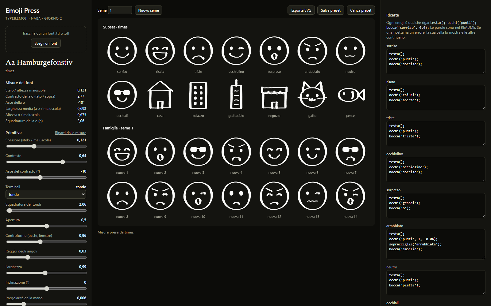

# TYPE&EMOJI - Emoji Press

> Archiviato il 28/10/2026: il tool del giorno 2 adesso è l'Emoji Kit, alla radice del repo. Questa versione resta intera e funziona da qui (apri `index.html` di questa cartella).

Tool p5.js per il giorno 2 del workshop TYPE&EMOJI (NABA, 3-4/12/2026, Fabrizio Falcone e Simone Verduci).

Si carica un font, il tool ne misura il carattere (spessore, contrasto, larghezza, occhio) e lo trasforma in primitive: da quelle nasce una famiglia di emoji, il subset del giorno 1 più 14 facce nuove scelte da un seme. Le primitive si spostano a mano, le emoji si riscrivono come ricette di poche righe, e la tavola si esporta in SVG vettoriale per il libretto.



`reference/` contiene il prototipo Python del 27/10/2026 (Comic Sans, 14 emoji costruite da primitive condivise) e la sua tavola: è il punto di partenza.

## Come si apre

Niente da installare, niente build. Serve la rete per p5.js (da jsdelivr) e, se manca Comic Sans, per Comic Neue (da Google Fonts).

1. **Doppio clic** su `index.html`: si apre nel browser e funziona da `file://`.
2. **Da un server statico**, per esempio dalla cartella del progetto: `python -m http.server 8000`, poi `http://localhost:8000`.
3. **Su editor.p5js.org**: un nuovo sketch, poi si caricano `index.html`, `sketch.js`, `core.js`, `recipes.js`, `font.js` e `style.css` sostituendo quelli dell'editor. Non provato (vedi sotto).

## Le tre colonne

- **Sinistra, il font.** Si trascina un `.ttf` o `.otf` sulla pagina (o «Scegli un font»). Il campione «Aa Hamburgefonstiv» si ridisegna col font, sotto ci sono le misure e gli slider delle primitive, che partono dalle misure. «Riparti dalle misure» rimette gli slider dove il font li aveva messi.
- **Centro, la tavola.** Il subset del giorno 1 (14 emoji) e la famiglia del seme (14 facce nuove), ridisegnati a ogni movimento.
- **Destra, le ricette.** Il testo di ogni emoji del subset, modificabile. Una ricetta con un errore lo scrive nella sua cella e nel suo riquadro; le altre continuano a disegnarsi.

In alto: **Seme** (un numero, sempre le stesse 14 facce per lo stesso numero), **Nuovo seme**, **Esporta SVG**, **Salva preset** e **Carica preset** (`.json` con primitive, ricette, seme e nome del font). Anche un preset si può trascinare sulla pagina.

## Le misure del font

Il font si disegna a 400 px su una tela nascosta e si leggono i pixel, come nel prototipo Python.

| Misura | Come | Diventa |
|---|---|---|
| Stelo / altezza maiuscole | larghezza della `l` a metà altezza / altezza della `H` | Spessore |
| Contrasto della o | spessore del fianco / spessore in alto della `o` | Contrasto (`1 - 1/rapporto`) |
| Asse della o | il raggio dal centro della `o` che incontra il tratto più sottile | Asse del contrasto (solo se c'è contrasto) |
| Larghezza media | media degli avanzamenti a-z / altezza maiuscole | Larghezza (0,7 = 1,0) |
| Altezza x / maiuscola | altezza della `x` / altezza della `H` | Controforme (0,7 = 1,0) |
| Squadratura della o | dove il contorno della `o` taglia la diagonale del suo riquadro | Squadratura dei tondi |

Terminali, apertura, raggio degli angoli, inclinazione e mano non si misurano: partono dai valori di default.

## Le primitive

| Slider | Cosa fa |
|---|---|
| Spessore (stelo / maiuscola) | lo spessore di ogni tratto, nella stessa proporzione stelo/maiuscola del font |
| Contrasto | quanto si assottigliano i tratti che corrono lungo l'asse: 0 è monolineare, 0,9 è un Bodoni |
| Asse del contrasto (°) | l'inclinazione del pennino: 0 è verticale, negativo come una penna calligrafica |
| Terminali | come finisce un tratto aperto: tondo, tagliato dritto o tagliato obliquo |
| Squadratura dei tondi | da 2 (ellisse) a 6 (quasi quadrato): testa, occhi, tondi |
| Apertura | quanto si aprono le curve aperte (bocche, occhi chiusi, archi): 0 si chiudono, 1 si aprono |
| Controforme (occhi, finestre) | la grandezza dei pieni e dei vuoti interni: occhi, lenti, finestre |
| Raggio degli angoli | quanto si arrotondano gli spigoli di linee, poligoni e rettangoli |
| Larghezza | stringe o allarga tutto in orizzontale, come un condensed o un extended |
| Inclinazione (°) | il corsivo: inclina tutto, positivo verso destra |
| Irregolarità della mano | quanto trema il tratto; 0 è un disegno tecnico |
| Seme della mano | cambia il tremolio senza cambiarne la quantità; stesso numero, stesso tremolio (niente sfarfallio) |

## Le ricette

Una ricetta è JavaScript con poche parole in più. Le coordinate stanno in un quadrato da -0,5 a 0,5, con `y` verso il basso: `(0, 0)` è il centro, `(0, -0.4)` è in alto. Gli angoli sono in gradi, 0 a destra e 90 in basso.

```js
testa();
occhi('punti');
bocca('sorriso', 0.6);
```

| Parola | Cosa disegna |
|---|---|
| `testa()` | il contorno della faccia |
| `occhi(tipo, grandezza = 1, y = -0.08)` | `'punti'`, `'grandi'`, `'chiusi'`, `'occhiolino'`, `'lenti'` |
| `bocca(tipo, ampiezza = 1)` | `'sorriso'`, `'triste'`, `'smorfia'`, `'aperta'`, `'o'`, `'piatta'` |
| `sopracciglia(tipo)` | `'arrabbiate'`, `'tristi'`, `'alzate'` (con le sopracciglia conviene `occhi('punti', 1, -0.04)`) |
| `linea([x, y], [x, y], ...)` | una linea aperta per i punti dati |
| `poligono([x, y], ...)` | una linea chiusa |
| `arco(cx, cy, rx, ry, da, a)` | un arco di ellisse da un angolo all'altro (sente l'apertura) |
| `tondo(cx, cy, rx, ry)` | un tondo (sente la squadratura) |
| `punto(x, y, r)` | un pieno, come un occhio |
| `rettangolo(cx, cy, w, h)` | un rettangolo dal centro |
| `finestre(colonne, righe, larghezza, altezza, cy)` | una griglia di finestre piene |
| `porta(x, base, w, h)` | una porta che poggia su `base` |
| `tenda(x0, x1, y0, y1, quante)` | una tenda a festoni, come nel negozio |

Si può usare tutto JavaScript: `for (const y of [-0.1, 0.1]) linea([-0.2, y], [0.2, y]);`. Un nome sbagliato (`occhi('storti')`) o una parentesi mancante diventano un messaggio rosso nella cella, non una pagina rotta.

## Comic Sans e Comic Neue

Il preset di partenza è Comic Sans MS, se il sistema ce l'ha (Windows e macOS sì). Il tool lo misura dal font di sistema, senza bisogno del file. Se il browser non lo trova (Linux, Chromebook) usa **Comic Neue** da Google Fonts (licenza OFL), e lo dice sotto il campione: «Comic Neue (al posto di Comic Sans)».

## Cosa è provato e cosa no

`python test/press_test.py` (Playwright con Edge, headless) apre la pagina da `file://` e poi da un server statico, carica `C:/Windows/Fonts/comic.ttf` e `times.ttf`, muove quattro primitive, cambia seme e controlla che lo stesso seme ridia le stesse facce, rompe una ricetta in due modi e controlla che le altre 27 celle si disegnino, esporta SVG (28 gruppi vettoriali, niente `NaN`) e JSON, cambia i valori e ricarica il JSON controllando che tornino uguali, e salva gli screenshot in `docs/screens/`. Nessun errore in console. Ultima prova: 27/10/2026, Windows 11, Edge, p5.js 2.3.4.

Misure ottenute: Comic Sans (di sistema e `comic.ttf`, uguali) stelo/maiuscola 0,122, contrasto 0,97, larghezza 0,652, x/maiuscola 0,702, squadratura 2,14; Times New Roman stelo/maiuscola 0,121, contrasto 2,77, asse -10°, larghezza 0,693, x/maiuscola 0,675, squadratura 2,06.

Non provato:

- il trascinamento con un mouse vero (il test passa i file dal selettore, che usa la stessa funzione);
- editor.p5js.org, Safari, Firefox, un Mac;
- un font senza i glifi `H l o x` (il tool lo dice nella barra di stato) o un font variabile;
- l'apertura dell'SVG in Illustrator o InDesign (si apre e si disegna in Edge);
- Comic Neue al posto di Comic Sans: su questa macchina Comic Sans c'è sempre.

Limiti noti:

- una ricetta con un ciclo infinito (`while (true)`) blocca la pagina: non c'è un timeout;
- il nome del font viene dal nome del file (`times.ttf` diventa «times»), non dalla tabella dei nomi del font;
- le curve più strette dello spessore del tratto (occhiolino, occhi chiusi) si disegnano come una catena di segmenti e dischi sovrapposti: in stampa è identico, ma in Illustrator quel tratto è fatto di tanti pezzi.
